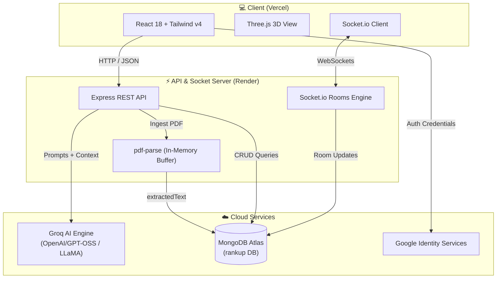

# 🎓 RankUp — Smart AI Learning Assistant & Multiplayer Study Arena

<div align="center">

[](https://rank-up-learning-assistant.vercel.app/)
[](https://github.com/Krish-Prasad09/RankUp-LearningAssistant)

[](https://react.dev/)
[](https://vitejs.dev/)
[](https://tailwindcss.com/)
[](https://threejs.org/)
[](https://nodejs.org/)
[](https://expressjs.com/)
[](https://socket.io/)
[](https://www.mongodb.com/)
[](https://console.groq.com/)

**Transform your study notes and textbooks into live multiplayer quiz battles, interactive flashcards, AI summaries, and actionable study plans.**

[✨ Key Features](#-interactive-features) • [🛠️ Tech Stack](#️-tech-stack) • [🏗️ Architecture](#️-system-architecture) • [🚀 Quick Start](#-running-locally) • [📡 API Reference](#-api-endpoints)

</div>

---

## 🌟 Overview

**RankUp** is a full-stack, AI-powered academic learning suite built for students and educators. Rather than passively reading dense PDF lecture notes, RankUp extracts, parses, and activates knowledge instantly:
- ⚡ **Zero-Base64 High-Capacity Engine**: Ingests up to 150–180 pages per document with raw text extraction at upload time, dropping database footprint by >95%.
- 🎮 **Live Multiplayer Quiz Battles**: Host real-time competitive study rooms with live synchronized countdowns, instant submissions, and real-time leaderboards over WebSockets.
- 🔍 **Search-Grounded AI Chat**: Ask questions strictly grounded in your syllabus, or toggle web-grounded pre-trained intelligence.
- 📊 **AI Learning Diagnostic Reports**: Detailed post-quiz mistake analysis detailing conceptual gaps, actionable advice, and custom study plans.

---

## ✨ Interactive Features

<details open>
<summary>💬 <b>1. Document Q&A & General Study Assistant</b></summary>
<br>

- 📄 **Document-Locked Mode**: Strict RAG-style boundary — answers *only* from the text extracted from your uploaded PDF.
- 🌐 **Web-Grounded Mode**: Combines course syllabus context with external knowledge for deeper explanations.
- 🤖 **General Study Chat**: A dedicated global study tutor available across your workspace for quick conceptual breakdowns.
- ⚡ **Instant Response Streaming**: Powered by Groq ultra-low-latency LPU inference.

</details>

<details>
<summary>🎴 <b>2. Active Recall Flashcard Studio</b></summary>
<br>

- 🔄 **3D Flip Interaction**: Interactive flashcards built with smooth CSS 3D transforms for optimal active recall retention.
- 🎯 **Non-Redundant Generation**: AI inspects previously generated cards to append brand new, unique questions every batch.
- 📥 **Export to Print-Ready PDF**: Download beautifully structured PDF flashcard decks powered by PDFKit for offline revision.

</details>

<details>
<summary>📝 <b>3. Intelligent Quizzes & Multi-Document Generator</b></summary>
<br>

- 🎲 **Flexible Difficulty**: Choose between *Easy* (direct recall), *Medium* (conceptual links), or *Hard* (edge cases & multi-step application).
- 📂 **Cross-Folder Quiz Synthesis**: Select individual documents or whole subject folders to synthesize comprehensive semester-end exam quizzes.
- 📈 **Attempt History & Score Tracking**: Keeps a persistent record of all quiz attempts, percentage scores, and timestamps.
- 🧠 **AI Performance Diagnostics**: Identifies specific knowledge gaps from incorrect answers and auto-generates a targeted improvement plan.

</details>

<details>
<summary>🏆 <b>4. Real-Time Multiplayer Battle Arena</b></summary>
<br>

- 🔴 **Real-Time WebSockets (`Socket.io`)**: Low-latency room state synchronization.
- 🔑 **6-Character Room Codes**: Easily share room codes with classmates or study groups.
- ⏱️ **Server-Authoritative Clock**: Prevents client clock desynchronization with automatic room finalization when time expires.
- 👑 **Host Controls**: Hosts can start the battle, track live submissions, and end the quiz on demand.
- 🥇 **Dynamic Live Leaderboard**: Sorts competitors dynamically by total score and submission speed.

</details>

<details>
<summary>📂 <b>5. Hierarchical Folder Organization</b></summary>
<br>

- 📁 **Nested Academic Folders**: Organize study materials by subject, semester, or course module (`/Physics/Semester-1/Mechanics`).
- 🛡️ **Parent Validation & Cascading Delete**: Recursive cleanup of all sub-documents and activity logs upon folder deletion.
- ⚡ **Direct Text Extraction**: Fast text parsing directly from memory buffers — no slow disk I/O or MongoDB 16MB document size ceiling.

</details>

<details>
<summary>📅 <b>6. Academic Task Planner & Color-Coded Calendar</b></summary>
<br>

- ✅ **Interactive Checklist**: Track assignments, lab reports, and exam deadlines.
- 🎨 **Visual Calendar Tags**: Tag specific dates with color-coded badges (*indigo, emerald, amber, rose*).
- 🔥 **Learning Streak**: Real-time gamified streak counter tracking daily document and quiz engagement.

</details>

<details>
<summary>🪐 <b>7. Interactive 3D WebGL Graphics</b></summary>
<br>

- 🌍 **Three.js & React Three Fiber**: Realistic rotating Earth globe with atmospheric cloud shaders and OrbitControls on login and registration pages.
- ⚖️ **Newton's Cradle Physics Loader**: Hand-crafted CSS keyframe physics simulation during application bootstrap.

</details>

---

## 🛠️ Tech Stack

### Frontend Architecture
| Component | Tech | Purpose |
|:----------|:-----|:--------|
| ⚛️ **Framework** | React 18.3 + Vite 5.4 | Fast SPA rendering & instant HMR |
| 🎨 **Styling** | Tailwind CSS v4 | Clean Slate & Indigo SaaS aesthetic |
| 🌐 **3D Graphics** | Three.js + `@react-three/fiber` + `@react-three/drei` | WebGL 3D Earth planet visualization |
| 🔌 **Sockets** | `socket.io-client` 4.8 | Bidirectional multiplayer event bridge |
| 🧭 **Routing** | React Router v6 | Protected routes, layout outlets & breadcrumbs |

### Backend Architecture
| Component | Tech | Purpose |
|:----------|:-----|:--------|
| 🟢 **Runtime** | Node.js (ESM modules) | Server-side JavaScript runtime |
| 🚀 **Framework** | Express 4.19 | REST API routing and middleware |
| ⚡ **WebSocket Server** | Socket.io 4.8 | Real-time multiplayer room state |
| 💾 **Database** | MongoDB Atlas + Mongoose 8.5 | Cloud NoSQL persistence with schemas |
| 📄 **Text Processing**| `pdf-parse` | In-memory raw text extraction |
| 🖨️ **PDF Generation** | `pdfkit` | Vector-rendered downloadable study sheets |
| 🤖 **AI Engine** | Groq Cloud API | High-throughput LPU model inference |
| 🔐 **Authentication** | JWT + Google OAuth 2.0 | Encrypted passwords (`bcryptjs`) & token verification |

---

## 🏗️ System Architecture



---

## 📁 Project Directory Structure

```
RankUp-LearningAssistant/
├── 📂 frontend/                      # Client-side React Application
│   ├── 📂 public/                   # Static assets, GLTF 3D planet model, textures
│   └── 📂 src/
│       ├── 📂 components/           # TopBar, UploadModal, Newton's Cradle loader
│       │   └── 📂 document/         # Workspace tabs: ChatTab, FlashcardsTab, QuizTab, SummaryTab
│       ├── 📂 context/              # AuthContext (JWT & Google authentication state)
│       ├── 📂 layouts/              # SidebarLayout & navigation
│       ├── 📂 pages/                # Dashboard, Documents, Workspace, Chat, Tasks, Quizzes, Auth
│       ├── 📂 services/             # API client (fetch) & Socket.io client
│       └── 📄 index.css             # Tailwind v4 styles & keyframe physics animations
│
├── 📂 backend/                       # Server-side Node.js Application
│   ├── 📂 config/                   # MongoDB Mongoose connection
│   ├── 📂 controllers/              # Auth, Documents, Chat, Flashcards, Quiz, Tasks, Rooms
│   ├── 📂 middleware/               # JWT token authentication & Multer memory upload
│   ├── 📂 models/                   # User, Document, Folder, Task, QuizRoom, Activity schemas
│   ├── 📂 routes/                   # Express route dispatchers
│   ├── 📂 socket/                   # Socket.io multiplayer room handlers & disconnect timeouts
│   └── 📂 utils/                    # Groq API client & PDFKit vector exporter
│
├── 📄 package.json                   # Root orchestrator (concurrently)
└── 📄 README.md                      # Documentation
```

---

## 🚀 Running Locally

### 📋 Prerequisites
- [Node.js (v18.0.0 or higher)](https://nodejs.org/)
- [MongoDB Atlas](https://www.mongodb.com/cloud/atlas) or a local MongoDB instance (`mongodb://localhost:27017/rankup`)
- [Groq API Key](https://console.groq.com/) *(free tier available)*

---

### ⚡ Step-by-Step Installation

**1. Clone the repository:**
```bash
git clone https://github.com/Krish-Prasad09/RankUp-LearningAssistant.git
cd RankUp-LearningAssistant
npm install
```

**2. Configure the Backend environment:**
```bash
cd backend && npm install
```
Create a `.env` file in the `backend/` directory:
```env
PORT=8000
MONGODB_URI=your_mongodb_connection_string
JWT_SECRET=your_jwt_secret_key_here
GROQ_API_KEY=gsk_your_groq_api_key_here
GROQ_MODEL=openai/gpt-oss-120b
GOOGLE_CLIENT_ID=your_google_oauth_client_id.apps.googleusercontent.com
CLIENT_URL=http://localhost:5173
```

**3. Configure Frontend & Run:**
```bash
cd ../frontend && npm install
cd ..
npm run dev
```

> 🌐 **Frontend Dev Server**: [http://localhost:5173](http://localhost:5173)  
> ⚡ **Backend API Server**: [http://localhost:8000](http://localhost:8000)

---

## 📡 API Endpoints

### 🔐 Authentication (`/api/auth`)
| Method | Endpoint | Description |
|:-------|:---------|:------------|
| `POST` | `/api/auth/register` | Register a new user account with email and password |
| `POST` | `/api/auth/login` | Authenticate existing credentials and return JWT |
| `POST` | `/api/auth/google` | Verify Google One Tap ID credential and sign in |
| `GET` | `/api/auth/me` | Fetch authenticated profile data |

### 📂 Documents & Folders (`/api/documents`)
| Method | Endpoint | Description |
|:-------|:---------|:------------|
| `POST` | `/api/documents` | Upload PDF and extract text directly into database |
| `GET` | `/api/documents` | List user documents (supports pagination and folder path) |
| `GET` | `/api/documents/:id` | Retrieve full document text, summary, flashcards, and quizzes |
| `PATCH` | `/api/documents/:id` | Rename document |
| `DELETE`| `/api/documents/:id` | Delete document and related activity logs |
| `GET` | `/api/documents/folders` | List folders for user |
| `POST` | `/api/documents/folders` | Create a new nested folder with parent validation |
| `DELETE`| `/api/documents/folders` | Cascading delete of folder and all child files |

### 🤖 AI Study Features (`/api/documents/:id`)
| Method | Endpoint | Description |
|:-------|:---------|:------------|
| `POST` | `/api/chat` | Global stateless study tutor conversation |
| `POST` | `/api/documents/:id/chat` | Contextual Q&A within uploaded document |
| `GET` | `/api/documents/:id/summary` | Generate / retrieve Quick & Detailed AI summaries |
| `POST` | `/api/documents/:id/flashcards` | Generate 5 new unique flashcards |
| `GET` | `/api/documents/:id/flashcards/export` | Download flashcard deck as formatted PDF |
| `POST` | `/api/documents/:id/quiz/generate` | Auto-generate multiple-choice quiz |
| `POST` | `/api/documents/:id/quiz/attempt` | Grade submitted answers and log score |
| `POST` | `/api/documents/quiz/generate-from-folders`| Cross-synthesize quiz from multiple documents |
| `POST` | `/api/documents/quiz/analyze` | AI performance gap analysis & study roadmap |

### 🎮 Multiplayer Arena (`Socket.io`)
| Event Name | Direction | Payload | Description |
|:-----------|:----------|:--------|:------------|
| `quiz:join` | Client ➔ Server | `{ code }` | Join room via 6-character code |
| `quiz:start`| Host ➔ Server | `{ code }` | Start countdown and activate quiz battle |
| `quiz:submit`| Client ➔ Server | `{ code, answers }` | Submit player answers and calculate score |
| `quiz:finish`| Host ➔ Server | `{ code }` | Force-finish room and reveal final leaderboard |
| `room:update`| Server ➔ Room | `{ room }` | Broadcast real-time room and leaderboard state |

---

## 🔒 Security & Performance Highlights

- 🛡️ **Zero Base64 Database Bloat**: By extracting plain text at upload time using `pdf-parse`, document storage in MongoDB Atlas was reduced by **>95%**, completely preventing `BSONObjectTooLarge` limits.
- ⚡ **Instant AI Inference**: Groq's Tensor Streaming architecture yields sub-second generation times for complex 20-question multi-document quizzes.
- 🔑 **Stateless & Scalable Sessions**: Authenticated via standard `Bearer <JWT>` tokens with BCrypt password hashing (10 salt rounds).
- ⏱️ **Auto-Finish Room Timeouts**: Server timers auto-close abandoned games to prevent stale Socket.io connections.

---

## 📄 License

This project is open-source and available under the [MIT License](LICENSE).

<div align="center">
  <b>Built with ❤️ for learners worldwide. Turn your study sessions into ranks! 🏆</b>
</div>
